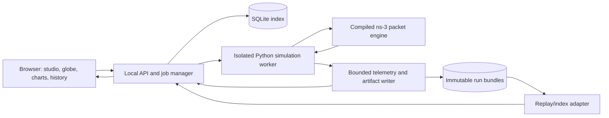

# LEO Mission Control — dashboard implementation plan

Status: frontend implemented, with a working local API/worker integration and Compose packaging. See [DASHBOARD_STATUS.md](GUIDE.md) for delivered features, verification and remaining release gates. Phase 5 learning remains deferred until release acceptance. This document is the product/contract specification; [REMAINING_WORK.md](../REMAINING_WORK.md) is the maintained progress and ownership checklist.

## 1. Product brief

> A single local web app that opens to a dark mission control screen: a glowing 3D Earth with satellites and links moving in real time, with metrics visible. From there, design a constellation, launch a simulation, watch it run, and later pull up any past run to replay and compare. One command starts it; mentors open it in a browser.

The home screen is the working mission view, not a marketing page or an empty collection of cards. The globe and telemetry remain the visual center while setup, run inspection and history open around them. Every displayed number must trace to simulation output; illustrative traffic animation must be identified as such.

**Phase 4.5 — Mission Control dashboard** is implemented as the local product surface. Remaining frontend, backend, learned-policy and research responsibilities are assigned to four contributors in [REMAINING_WORK.md](../REMAINING_WORK.md). The final demonstration extends this dashboard.

Default deployment is a single-user application on the local machine. The same computer's browser opens the app; optional LAN access is a separate configuration with deliberate host binding/access controls. Internet hosting and multi-user collaboration are outside this phase's gate.

## 2. The experience

### Mission Control: the opening screen

A cinematic but legible Earth fills roughly two-thirds of the desktop workspace. A slim left rail switches modes; a right inspector shows selected object/run details; charts and a synchronized timeline occupy the lower region. The globe stays visible while panels change.

Always visible:

- Selected scenario/run, policy, seed and epoch.
- Explicit `PREVIEW`, `LIVE`, `PAUSED`, `SAVED REPLAY` or `FAILED/PARTIAL` state.
- Both simulation time and elapsed wall time, with progress and preparation stage.
- Control/Realtime/Bulk performance, delivery/drop/in-flight accounting, queues and link availability.
- Actions to design, launch, inspect and open history.

With no active run, show a real saved demonstration replay if one is installed, visibly labelled. Otherwise show a physically generated constellation preview with unavailable metrics shown as unavailable. No invented live counters.

Live means observations from an executing simulation. Simulation seconds are not assumed to equal wall seconds. The display interpolates geometry between received samples; it must not invent link availability, route changes or packet deliveries.

### Constellation Studio

Open an editing drawer alongside a large globe preview. Support:

| Group | Controls |
| --- | --- |
| Constellation | Planes, satellites per plane, inclination, altitude, Walker phasing, epoch and orbital start offset. |
| Ground network | Add/select/edit station name, latitude, longitude and elevation; place a station by clicking the globe. |
| Physical links | Range/elevation limits, ISL and ground capacities, terminal/beam counts, acquisition, hysteresis, dwell and initial readiness. |
| Packet network | Queue limits, MTU, TTL and gateway transit permission. |
| Traffic | Endpoints, class, protocol, start/end, payload size, UDP rate or TCP transfer bytes; class targets and seeded templates. |
| Experiment | Duration, physical update interval, control interval, policy and forecast settings. |

Use the existing JSON scenario as the canonical experiment configuration. Add dashboard-only names/tags/preset IDs outside it so cosmetics do not change experiment hashes. Import/export scenario JSON and save named immutable revisions.

Provide the checked-in normal/burst/overload/handover examples as presets. Beginner controls show meaningful essentials; advanced sections expose the full supported configuration. Show units, per-direction capacity semantics and experimental assumptions. Estimate workload size, update count and memory implications before launch; current fine-control runs can be expensive.

Preview requests are debounced and generation-tagged so an older response cannot overwrite a newer design. Server validation uses the existing geometry/configuration rules. Preview never advances packets or reports packet-performance metrics. Edits apply to the next run; an active run retains its frozen configuration.

### Launch and live run

Validate → freeze scenario/policy versions → create immutable run ID → queue → prepare topology/build engine → simulate → finalize → archive. Show all stages, not just a spinner until packet simulation begins.

Run controls:

- Launch and cancel, with explicit requested/acknowledged states.
- A cooperative engine pause/resume at a defined control boundary, with the actual paused simulation timestamp. Do not implement engine pause by merely freezing the globe or suspending an arbitrary OS process.
- Separate `Pause view` / `Catch up to live` controls. Their effect is presentation only and must not be confused with engine pause.
- Playback speed and seek for saved replay; no rewinding an executing simulation.
- Opening another page or disconnecting a browser does not stop the worker. Reopening reconnects to the same job.

One simulation runs at a time initially; additional jobs queue. A stopped/failed job remains inspectable, with partial results clearly labelled. Cancellation terminates the owned Python worker and ns-3 child, never unrelated processes, and cannot leave an apparent successful result.

### Run Library and replay

Persist run identity, timestamps, name/tags, policy/checkpoint, scenario hash, status, summary and artifact references. Browse, search and filter by scenario, class, policy, seed, date and status. Reopen a run, duplicate its configuration, replay it, compare it, and export its bundle.

Existing `runs/` directories must be discoverable/importable. Persist an index so history survives application restarts. Imports never move, overwrite or delete the original artifacts. Deduplicate using stable identity/hashes, not just folder names.

Replay supports play/pause, speed, seek, stepping to an event, bookmarks and navigation to congestion, deadline failures, link removal/acquisition and route changes. Keep the globe, charts and inspector aligned to the same simulation timestamp. Seeking loads indexed chunks rather than loading a whole run into browser memory.

Older runs may have incomplete geometry or compact control records. Recover values only when source scenario/orbit data and correct historical semantics are available; otherwise show unavailable layers. Never fill missing historical metrics with zeros or regenerate changed terminal rules and present them as the original topology.

### Compare

Select two runs first; expand to a small set only if it remains readable. Show synchronized globe views or a selectable shared globe, class charts and differences in metrics. Compare simulation time, relative episode time or a named event only through an explicit alignment mode.

Check scenario hashes, duration, demand, capacities, scheduler, service targets, physical model and policy versions. A policy-effect comparison needs matched conditions; mismatched runs remain viewable with a clear differences panel. Do not imply that different demand/capacity runs isolate policy quality.

Compare urgent deadline success and survivor-only latency alongside delivery, drops, in-flight packets, Bulk goodput/fairness/service gaps, route churn and forecast error. Null/insufficient-data results stay null. Include unfavorable outcomes, including the currently poor Control deadline results.

### Policy Lab: Phase 5 integration surface

Before Phase 5, expose the six implemented heuristic/baseline policies through a capability registry. A future learned-policy area explains that training is deferred; it does not offer a functioning PPO switch or fake training chart.

After Phase 5, the same surface gains checkpoint selection, training jobs, episode progress, reward components, held-out evaluation and matched heuristic/learned comparisons. This is an extension of the run/job system, not a second dashboard.

## 3. Visual direction: a scientific mission room

The memorable moment is a selected route crossing the Earth while a real handover event changes a link, with its queue/deadline impact appearing on the synchronized charts. Provide a guided presentation flow around that event.

- Deep midnight background, restrained atmospheric rim light and a high-quality Earth surface with locally bundled/licensed textures. Quiet orbit traces and a sparse star field provide depth without competing with data.
- Off-white typography, cyan active routes, amber acquisition/pressure and red failures. Class colors remain stable in all views, supplemented by labels, symbols and line styles.
- Distinctive display typography paired with readable UI text; tabular numerals and explicit units for metrics. Fonts must be bundled for offline demos.
- Strong composition: globe first, compact operational controls, a purposeful inspector and carefully spaced chart bands. Avoid a wall of equal KPI cards, constant flashing, arbitrary gauges and decorative chart noise.
- Satellites use restrained bloom, trails and selection halos. Link rendering distinguishes active, acquiring (when recorded), unavailable and selected-route states.
- Physical ISLs are straight segments in the shared 3D frame. An optional curved route overlay is a presentation aid, not a different propagation path. Aggregate traffic pulses are labelled as illustrative; actual packet playback requires recorded packet timing/path data.
- Pointer/keyboard selection, camera focus/follow, orbit/zoom, route isolation, station labels and congestion filters. Provide a 2D fallback for browsers without usable WebGL.
- Render smooth camera/object motion independently of simulation events. No per-frame React state updates for hundreds of objects. Respect reduced motion, readable contrast and projector visibility.
- Desktop-first layouts at 1440×900 and 1920×1080, usable at 1366×768; smaller screens prioritize controls/metrics over simultaneous dense panels.

Presentation mode hides editing chrome, uses larger typography and supports keyboard bookmarks. Bundle a documented recorded handover and a baseline comparison for an offline mentor walkthrough. Live runs must remain accessible; a prerecorded replay is always identified.

## 4. Architecture grounded in the repository

Recommended stack: React + TypeScript SPA, Vite build, Three.js through React Three Fiber for the globe, a small chart layer selected in the UI spike, FastAPI for the local API, SQLite metadata/index and filesystem artifact bundles. Pin compatible versions with lockfiles during implementation. Package the frontend build with the Python service so one application origin serves UI, API and telemetry.

Why this arrangement: the simulator and scientific dependencies stay in Python/Linux, while the browser owns interaction and rendering. The existing OpenGL viewer remains useful as a diagnostic reference; shared simulation data is reused rather than maintaining a second topology implementation. No client-side orbit propagator, queue simulator or route optimizer is introduced.



The API process remains responsive while an owned worker runs the simulator and its child ns-3 process. Use one local API process and an explicit worker/job supervisor initially, not multiple API workers competing over an in-memory queue. SQLite serializes durable job transitions. A durable queue/status record and startup reconciliation identify interrupted runs after a crash. A distributed task service is unnecessary for the initial single-machine workload.

FastAPI's documentation distinguishes small in-process background tasks from heavy computation; use an isolated worker for simulations ([official background-task guidance](https://fastapi.tiangolo.com/tutorial/background-tasks/)). React Three Fiber documents instancing and keeping frequent animation updates out of React state; use these practices for satellites/links ([performance guidance](https://r3f.docs.pmnd.rs/advanced/scaling-performance), [animation pitfalls](https://r3f.docs.pmnd.rs/advanced/pitfalls)).

### Integration contracts

| Integration source/artifacts | Required dashboard behavior |
| --- | --- |
| `experiments.run.run()` is synchronous and finalizes metrics after execution. | Worker entry point with progress/lifecycle hooks and cancellation ownership. |
| `controller.execute()` has current queues/routes at control ticks, but writes `control.json` at the end. | Optional observer sink independent of the policy; bounded live snapshots without changing action ordering. |
| UDP outcomes and TCP delivery are finalized/recorded inside the C++ engine. | Add current cumulative delivery/drop/in-flight/byte counters and required outcome samples for genuine live metrics. Queue observations alone cannot yield live deadline success. |
| Raw events can be large; compact controls omit fields. | Incremental aggregation and indexed/chunked replay data; capability flags for missing fields. |
| Prepared plans contain link schedules but discard full orbital positions; orbital CSV/configuration remain. | Record all satellite/ground positions and coordinate/time metadata at visualization samples in a separate bounded artifact. Generate geometry from the authoritative backend model, not independent browser physics. |
| Node positions use inertial coordinates; Earth/stations rotate. | Export a consistent visualization frame, preferably backend-derived ECEF positions in km, plus epoch/sample times; preserve physical distances and synchronize Earth orientation. |
| Current installed actions are class destination trees. | Policy-independent route/forecast overlays with class IDs and actual packet-path overlays kept distinct. |
| `status.json` only reports running/complete/failed. | Supervisor lifecycle states plus consistent partial/final status mapping; do not silently reinterpret historical status files. |

Observer and geometry collection must not reveal future snapshots/traffic to a routing policy. A viewer may show a clearly labelled orbit preview or forecast, but policy observation boundaries stay unchanged. Rendering and telemetry must not alter ns-3 simulated delays or event ordering.

## 5. Live telemetry and persistence contracts

Proposed public resources live under `/api/v1/`:

| Resource/action | Purpose |
| --- | --- |
| `GET /capabilities` | Supported policy kinds, configuration schemas, engine availability, artifact/replay versions and limits. |
| `GET/POST /scenarios`; `GET /scenarios/{id}` | List/create immutable scenario revisions. |
| `POST /previews` | Validate and generate a cancellable bounded constellation preview; returns a preview ID. |
| `POST /runs`; `GET /runs`; `GET /runs/{id}` | Create an accepted job (202), browse and inspect status. |
| `POST /runs/{id}/commands` | Validated pause/resume/cancel requests with request IDs; acknowledge accepted/applied/rejected. |
| `GET /runs/{id}/stream` | Server-sent events for telemetry/status, with sequence IDs and reconnect support. |
| `GET /runs/{id}/metrics` | Windowed/downsampled time-series queries with units and denominator definitions. |
| `GET /runs/{id}/replay` | Chunk/keyframe queries for a bounded time interval. |
| `GET /runs/{id}/artifacts`; `GET /runs/{id}/export` | Inspect artifacts and export a portable bundle. |
| `POST /imports` | Validate and index an existing artifact directory/bundle. |
| `POST /comparisons` | Save selected run IDs, alignment and configuration-difference metadata. |

Use normal HTTP commands plus SSE because commands are infrequent and telemetry is one-directional. A WebSocket can replace the transport later if a demonstrated need arises; browser rendering must not hold the routing handshake open. Schemas and typed errors come from the Python API specification.

Job states: `queued → preparing → running ↔ paused → finalizing → completed`, with `cancelling → cancelled`, `failed` and `interrupted` branches. Progress includes stage, completed simulated time and duration; a speculative wall-time estimate is separate. Worker acknowledgements, rather than UI optimism, determine state.

Each stream message has schema version, run ID, monotonically increasing sequence, simulation timestamp, wall timestamp, kind and payload. Distinguish full snapshots from deltas. Reconnect fetches a current snapshot and sequence; replay missed durable events only within retention bounds. A gap cannot silently masquerade as uninterrupted live data.

Keep three independent cadences: physics/control as configured by the experiment, bounded telemetry delivery (initial target 2–5 Hz wall time), and browser rendering (target 30–60 fps). Archive exact discrete state transitions plus periodic geometry/metric keyframes. Coalesce replaceable live snapshots for slow clients; persist critical status/handover/drop summaries before delivery and recover them through indexed replay. Never create unbounded queues of full observations.

Metric records identify cumulative versus rolling-window values and provisional versus final outcomes. Preserve datagram accounting, censoring of not-yet-due deadlines, TCP stream semantics, active/run-window goodput and survivor-only latency. Live p95/p99 must specify their window/sample count; any sketch or sampling approximation is labelled. Final summaries reconcile exactly with the existing offline summarizers on the same run. A stopped job never displays partial values as a completed experiment.

Persist metadata in SQLite and large arrays/events in versioned files. Validate indexed paths against configured artifact roots; API clients send run IDs rather than arbitrary shell commands or filesystem paths. Exports declare source/dependency/scenario/policy hashes and data capabilities. First-party saved results remain immutable; labels/bookmarks live in index metadata.

The retained visualization artifact includes all node types, frame/unit conventions, timestamps, topology transitions, class routes, metric-series versions and forecast provenance. Legacy schema 2/3/4 results go through adapters; new replay fields get their own explicit version. Do not load a hundred-megabyte JSON control log in the browser or read it afresh for each chart request.

## 6. Phase 5 compatibility from the beginning

Policy registry entries describe ID, label, kind (`heuristic`, `learned`), supported observation/action versions, class routing, forecasts, checkpoint requirements and explanation fields. The UI queries capabilities instead of hardcoding a list of six policy buttons.

A future checkpoint manifest identifies algorithm, file hash, observation/action encoder, training configuration/seeds, simulator/model version, service targets and supported constellation dimensions. Validate compatibility before launch; a fixed-size learned encoder may reject a newly designed constellation. An incompatible or missing checkpoint cannot silently run a different heuristic. Any explicit fallback is recorded and displayed.

The job abstraction reserves `simulation`, `training` and `evaluation` kinds, but this dashboard phase implements simulation/evaluation of existing policies only. Future training progress uses episode/iteration/reward/constraint fields; inference runs keep the normal simulation metric contract. UI modules activate through capabilities when Phase 5 supplies them.

Keep live viewer telemetry separate from a policy's observation and training reward channels. Rendering a future orbit preview must not leak future realized queues, packet outcomes or evaluation labels into an agent. Preserve offline training/frozen evaluation as the planned default; the dashboard displays whether weights are fixed or being updated.

Show policy explanations according to what is available: heuristic score components/fallback reasons now, candidate actions/masks/confidence or value diagnostics later if implemented. Do not describe a probability or attention map as a causal explanation.

## 7. Delivery sequence and review gates

| Milestone | Concrete deliverable | Acceptance evidence |
| --- | --- | --- |
| D1 — Contracts and visual direction | Scenario/run/replay schemas, capability registry design, static mission-control prototype using a real saved run and local Earth assets. | Mentor-scale screens show a clear globe/metrics hierarchy; sample values and replay are identified. Frame/units and missing-field behavior specified. |
| D2 — Constellation Studio | Editable setup, server validation, accurate preview, presets and scenario import/export. | Generated scenario round-trips through existing preparation; station placement/units agree with backend; invalid/resource-heavy setups get actionable feedback. |
| D3 — Run supervisor and telemetry | Isolated worker, job persistence, bounded metrics/geometry feed, launch/cancel and acknowledged pause/resume. | A real run visibly progresses before completion; UI stays responsive; browser reconnect and process failure leave consistent states; existing deterministic outputs are unchanged by viewing. |
| D4 — Library and replay | Persistent index, legacy import adapters, chunked replay, scrubbing/event bookmarks and exports. | Restart the app and reopen a saved run; seek aligns metrics/routes/globe; unsupported old layers are labelled; no full-log browser load. |
| D5 — Comparison and presentation | Matched-condition checks, class charts, synchronized views and offline presentation mode. | Demonstrate congestion/handover and favorable/unfavorable policy tradeoffs from reproducible data, entirely offline after installation. |
| D6 — Phase 5 readiness and release | Policy/checkpoint capability contract, simulated learned-adapter integration test, Compose launcher and documentation. | Swap a contract-test adapter without UI changes; incompatible encoders rejected; complete acceptance checklist below passes. No PPO implementation required. |

D1 establishes the design direction; visual refinement continues through D6. The controller/telemetry vertical slice is mandatory before spending the remaining effort on effects and presentation polish.

## 8. Definition of dashboard complete — gate before Phase 5 resumes

- One documented command, planned as `docker compose up --build`, starts the packaged local UI/API/worker after Docker installation. URL and engine readiness are visible. Subsequent offline startup uses already built images/assets without fetching tiles/fonts. Native developer startup is documented separately.
- A mentor can open the browser, load a preset, edit its constellation/stations/traffic, validate and launch it without terminal work.
- A real running job produces visible live metrics and topology before completion. Pausing the view and pausing the engine are distinct and correct. Cancellation/failure/closing the tab cannot corrupt a completed run or strand an owned engine process.
- History survives restart. A past run can be reopened, replayed, inspected and exported. A compact legacy run imports with honest missing-data labels.
- Two saved runs compare with synchronized clocks and configuration-difference checks. Final metric values match authoritative artifacts; provisional/live values are labelled and reconcile on completion.
- The refined 200-satellite handover/burst scenario remains usable on the current machine. Establish a measured RAM/runtime baseline and test 30 fps minimum for the primary view on the demo machine, with adaptive quality/2D fallback. Measure UI/telemetry overhead relative to headless runs; set a release budget from the D3 benchmark rather than assuming zero cost.
- No policy receives additional future information. Existing simulation tests still pass; semantic result hashes agree with headless execution when telemetry is enabled/disabled, after accounting for explicitly versioned provenance fields.
- The policy/checkpoint capability contract supports a future trained policy without replacing pages or storage schemas. A test adapter validates that path; it is not presented as a trained model.
- Browser tests cover setup/launch/reconnect/cancel/history/replay/compare; metrics/frame transformation and import tests cover correctness. Visual review covers projector readability, reduced motion, selection, WebGL failure and offline demo assets.
- A guided 3–5 minute mentor walkthrough works: design → launch → observe queues/route/handover → reopen saved run → compare policies and discuss a limitation. Record the real case IDs and event bookmarks used.

Phase 5 resumes after these gates pass. Phase 6 calibration can proceed independently. Phase 7's final experiment system and Phase 8's final research packaging consume the dashboard's stable contracts; this phase does not replace their research responsibilities.

## 9. Repository responsibilities

```text
constellation/             Orbital inputs, terminal lifecycle and topology snapshots
packet_backend/            ns-3 engine, policies, scheduling and scientific metrics
experiments/               CLI runs, matched comparisons and sensitivity experiments
dashboard/                 API, job supervision, telemetry adapters and persistence
web/                       Browser mission view, Studio, library and comparison
requirements/              Pinned orbital, ns-3, dashboard and development dependencies
Dockerfile                 Packaged UI/API/worker image
compose.yaml               Local runtime and durable run mount
```

Run from the repository root using module entry points; see [the documentation index](../README.md). Existing Python/ns-3 environments stay separated; the packaged UI build adds a build stage rather than requiring users to install Node in the packet environment. Use Docker's existing linux/amd64 constraint for the engine, preserve writable run volumes and host ownership, expose only the intended local port, and test the documented Windows/macOS command flow before claiming those host platforms are validated.
